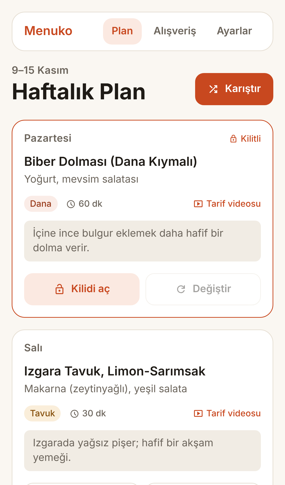

# Menuko

Haftalık yemek planı ve alışveriş listesi uygulaması. Expo (React Native) + TypeScript ile yazıldı; iOS, Android ve web'de çalışır.

<p>
  
  
  
</p>

## Özellikler

- **Plan:** 7 günlük menü; günleri kilitleme, tek günü değiştirme, kilitsiz günleri karıştırma, YouTube'da tarif arama.
- **Alışveriş:** Plandan otomatik çıkan, kategorili liste. Aynı malzemeler tek satırda toplanır, miktarlar kişi sayısına göre hesaplanır, liste paylaşılabilir.
- **Ayarlar:** Kişi sayısı, günlere göre ana malzeme düzeni, istenmeyen malzemeler.
- Plan, kilitler, işaretler ve tercihler cihazda saklanır. Açık ve koyu tema desteklenir.

## Çalıştırma

```bash
npm install
```

```bash
npx expo start
```

Açılan menüde `i` iOS simülatörünü, `a` Android emülatörünü, `w` tarayıcıyı açar. Telefonda denemek için Expo Go uygulamasıyla QR kodu okutun.

## Kontroller

```bash
npm test
```

```bash
npm run typecheck
```

```bash
npm run lint
```

## Yapı

| Yol | İçerik |
| --- | --- |
| `src/app/` | Ekranlar (Expo Router): `index` Plan, `shopping` Alışveriş, `settings` Ayarlar |
| `src/components/` | Ortak arayüz bileşenleri |
| `src/data/meals.ts` | Yemekler ve malzeme kataloğu |
| `src/lib/` | Plan oluşturma, alışveriş listesi ve tarih mantığı (testleriyle) |
| `src/store/app-store.ts` | Uygulama durumu ve cihazda saklama |
| `legacy/index.html` | İlk HTML prototipi (referans için) |

Yeni yemek eklemek için `src/data/meals.ts` içindeki `MEALS` listesine kayıt eklemek yeterlidir; miktarlar 3 kişi içindir.
