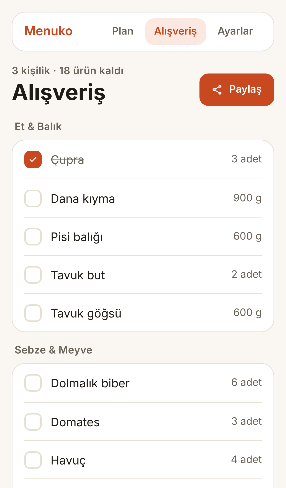
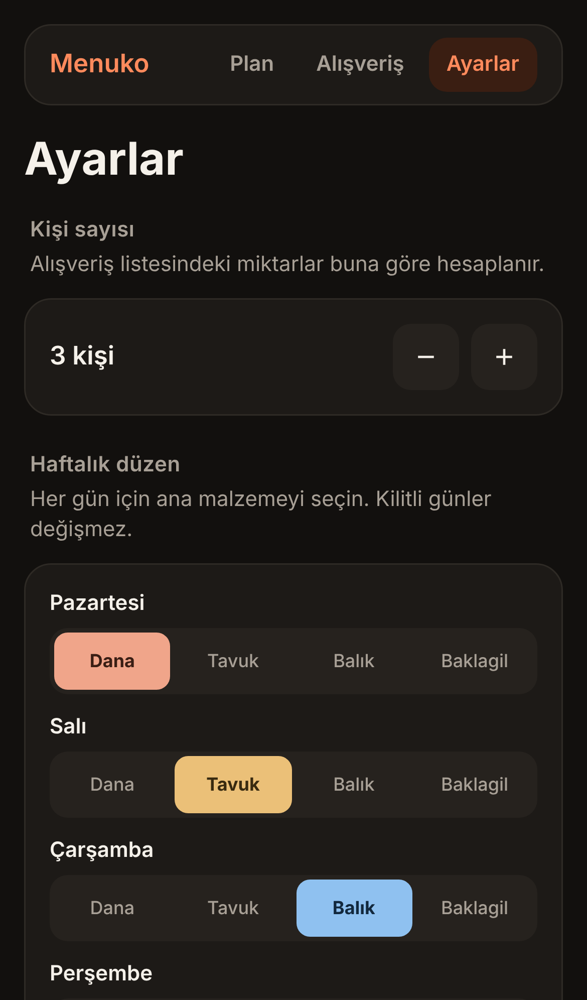

# Menuko

Haftalık yemek planı ve alışveriş listesi uygulaması. Tarayıcıda, iPhone'da ve Android'de çalışacak şekilde tek kod tabanından yazıldı.

<p>
  
  
  
</p>

## Özellikler

- **Bugün:** Açılış ekranı "Bugün ne pişirsem?". Plandaki bugünün yemeği en üstte; altında süreye (≤ 30 / ≤ 45 dk) ve türe göre "Şimdi ne pişireyim?" önerisi. Beğendiğin öneriyi tek dokunuşla bugünün planına koyabilirsin.
- **Plan:** 7 günlük menü; günleri kilitleme, tek günü değiştirme, kilitsiz günleri karıştırma, YouTube'da tarif arama.
- **Alışveriş:** Plandan otomatik çıkan, kategorili liste. Aynı malzemeler tek satırda toplanır, miktarlar kişi sayısına göre hesaplanır, liste paylaşılabilir.
- **Ayarlar:** Kişi sayısı, günlere göre ana malzeme düzeni (bir günde birden fazla tür seçilebilir; o gün için aralarından rastgele biri gelir), istenmeyen malzemeler.
- Plan, kilitler, işaretler ve tercihler cihazda saklanır. Açık ve koyu tema desteklenir.

## Yayın (GitHub Pages)

`main` dalına her değişiklik geldiğinde `.github/workflows/pages.yml` uygulamayı kendiliğinden derleyip yayınlar:

**https://iisler.github.io/menuko/**

Tek seferlik ayar: repo → Settings → Pages → *Build and deployment* → Source: **GitHub Actions**.

### Masaüstüne / ana ekrana kaydetme

- **Chrome / Edge (Mac, Windows):** adres çubuğundaki "Yükle" simgesi ya da menü → *Uygulamayı yükle*.
- **Safari (Mac):** Dosya → *Dock'a Ekle*.
- **iPhone:** Safari → Paylaş → *Ana Ekrana Ekle*.
- **Android:** Chrome menüsü → *Ana ekrana ekle*.

## Geliştirme

Bilgisayarda çalıştırmak için Node.js gerekir (yalnızca geliştirme için; yayın otomatik yapılır).

```bash
npm install
```

```bash
npx expo start
```

Menüde `w` tarayıcıyı, `i` iOS simülatörünü, `a` Android emülatörünü açar.

```bash
npm test
```

```bash
npm run typecheck
```

```bash
npm run lint
```

## Yapı

| Yol | İçerik |
| --- | --- |
| `src/app/` | Ekranlar: `index` Bugün, `plan` Haftalık plan, `shopping` Alışveriş, `settings` Ayarlar |
| `src/components/` | Ortak arayüz bileşenleri |
| `src/data/meals.ts` | Yemekler ve malzeme kataloğu |
| `src/lib/` | Plan oluşturma, öneri, alışveriş listesi ve tarih mantığı (testleriyle) |
| `src/store/app-store.ts` | Uygulama durumu ve cihazda saklama |
| `public/` | Web uygulaması bilgisi (manifest) ve ikonlar |
| `legacy/index.html` | İlk HTML prototipi (referans için) |

Yeni yemek eklemek için `src/data/meals.ts` içindeki `MEALS` listesine kayıt eklemek yeterlidir; miktarlar 3 kişi içindir.
